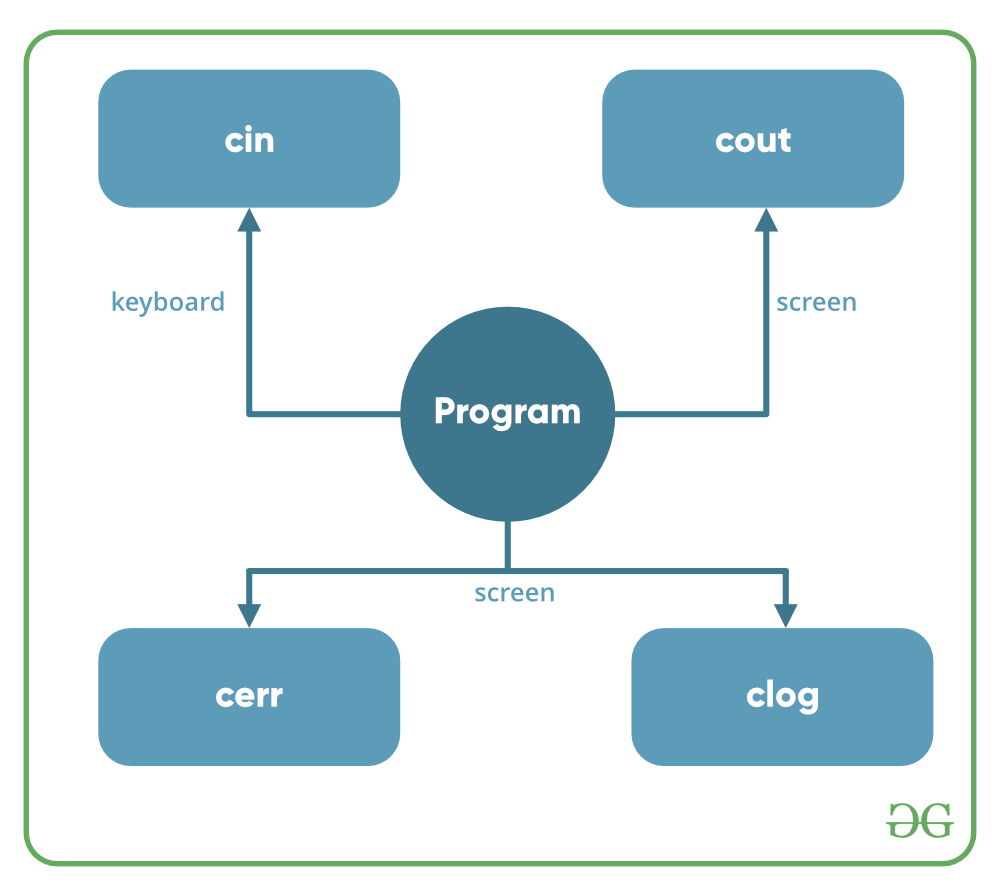
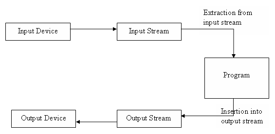
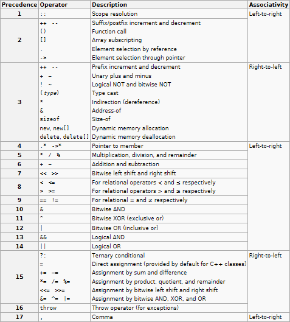

# Увод. Примитивни типове данни. Преобразуване между типове. Оператори.

## Термини

- Програма - последователност от инструкции, описващи как компютърът да изпълни определена задача.
- Компютърна програма - формално описание на действията, които компютърът трябва да извърши, написано на определен език за програмиране.
- Алгоритъм - крайна, строго детерминирана последователност от елементарни, изпълними стъпки (инструкции), която приема определени входни данни и след краен брой действия произвежда резултат (изход).
  - Формалната дефиниция чрез 5-те класически свойства (по Доналд Кнут)
    - крайност - алгоритъмът трябва гарантирано да прекратява изпълнението си след краен брой стъпки за всеки валиден вход (не изпада в безкраен цикъл).
    - детерминираност - всяка стъпка трябва да е строго и еднозначно дефинирана, без двусмислие. При един и същ вход винаги се преминава през същите междинни състояния и се получава идентичен резултат.
    - ефективност - всяка операция трябва да бъде достатъчно проста (елементарна), така че да може да бъде изпълнена механично за крайно време с наличните ресурси (лист и химикал или процесор).
    - вход - алгоритъмът приема нула или повече предварително зададени стойности.
    - изход - алгоритъмът произвежда поне една изходна величина (резултат), която решава поставената задача спрямо подадения вход.
- Програмиране -  процесът на проектиране, разработване, тестване и поддръжка на компютърни програми.
- Език за програмиране - формален език със синтаксис и семантика, чрез който се описва поведението на програма.
- Компилатор -  програма, която превежда програмен код от един език в друг, обикновено от език за програмиране към машинен код или междинно представяне.
- Среди за разработка/Среди за програмиране (IDE = Integrated Development Environment) - интегрирана среда за разработка, която обединява инструменти като редактор на код, компилатор, debugger, build система и други инструменти за разработка.

## Основна структура на C++/CPP програма
Нека разгледаме една от най-простите C++ програми:
```c++
#include <iostream>

// Това е началната функция на програмата.
int main()
{
    // Извеждаме текст на стандартния изход.
    std::cout << "Hello, World!\n";

    // Програмата приключва успешно.
    return 0;
}
```
Резултатът от изпълнението е:
```text
Hello, World!
```
Преди да разгледаме отделните части на програмата, нека видим коментарите.

### Коментари
Коментарите са текст в програмния код, който е предназначен за програмистите и не се изпълнява като част от програмата. Те се използват например за:
- обяснение на кода;
- описание на дадена логика;
- оставяне на бележки;
- временно изключване на част от кода.

В C++ има два основни вида коментари.
- Едноредов коментар
  - Започва с `//` и продължава до края на реда. 
  ```c++
  // Това е коментар.
  int x = 10; // Коментар след код
  ```
  - Всичко след // на същия ред се приема за коментар.
- Многоредов коментар
  - Започва с /* и завършва с */.
  ```c++
  /*
   Това е многоредов
   коментар.
  */
  ```
  - Може да се използва и в рамките на един ред:
  ```c++
  int x = 10; /* Това е коментар */
  ```

> Важно: Коментарите не променят поведението на програмата.
```c++
int x = 10;
// int x = 20;
```
вторият ред няма да бъде изпълнен, защото е коментар.

### `#include <iostream>`
`#include` е директива към preprocessor-а. Тя указва, че искаме да използваме функционалности, предоставени от iostream. Предоставя средства за стандартен вход и изход, включително:
```c++
std::cin
std::cout
std::cerr
```
На този етап е достатъчно да запомним: `#include <iostream>` позволява ни да използваме стандартните средства за вход и изход.

### `int main()`
`main` е специалната функция, от която започва изпълнението на програмата.
```c++
int main()
{
    // кодът на програмата
}
```
- int показва, че функцията main връща стойност от тип int.
- тази стойност се използва като exit status на програмата.

#### Защо main връща стойност?
След като програмата приключи, тя може да предаде на операционната система информация дали е завършила успешно или е възникнал проблем.
```c++
int main()
{
    // Код на програмата...

    return 0;
}
```
return 0; означава, че програмата е приключила успешно.  
Ако е възникнал проблем, можем да върнем ненулева стойност:
```c++
int main()
{
    // Възникнал е проблем...

    return 1;
}
```
Тук 1 е върната на операционната система като код за завършване. Какво точно означава конкретната ненулева стойност зависи от програмата.
> Важно: return 0 не връща стойност към потребителя на екрана. То връща код за завършване на операционната система.

#### Защо не return -1?
Съществува обща конвенция:
- 0 → успех
- ненулева стойност → грешка / неуспешно завършване

Затова 1, 2, -1 и други ненулеви стойности могат да се използват за грешки. Конкретното значение на всяка стойност се определя от програмата или платформата.  
Например една програма може да използва:
```c++
return 1; // Грешка при отваряне на файл
return 2; // Невалидни входни данни
return 3; // Друга грешка
```
Така друга програма или операционната система може да разбере дали изпълнението е било успешно и евентуално какъв тип проблем е възникнал.

```c++
int main()
{
    std::cout << "Hello, World!\n";
}

// При пропускане да напишем return, по default - return 0
// return 0;
```

### `{` и `}`
Фигурните скоби `{` и `}` определят **блок от код**.
В този пример всичко между тях е тялото на функцията main.
```c++
int main()
{
    // код
}
```

### `std`, `namespace` и `::`
В C++ много от готовите функционалности са организирани в пространства от имена (namespace).  
namespace се използва, за да групираме свързани имена и да избегнем конфликти между тях.  
Стандартната библиотека на C++ използва пространството от имена `std`.  

Затова например изходният поток `cout` се използва като: `std::cout`
- `std` е името на namespace-а;
- `cout` е име, което се намира в този namespace;
- `::` е операторът за достъп до име в определен scope.
  - Важно: `::` не се използва само с namespace. Това е оператор за достъп до име в определен scope и ще го срещаме и в други ситуации. Засега е достатъчно да го разбираме като начина, по който достъпваме име, намиращо се в даден namespace.

#### `using namespace std;`
Вместо да пишем `std::` пред всяко име от стандартната библиотека (`std::cout`, `std::cin`, `std::endl`), C++ ни дава възможност да използваме директивата:
```c++
using namespace std;
```
Тази директива „внася“ всички имена от пространството std директно в текущия scope. Така можем да пишем просто `cout` и `cin`:
```c++
#include <iostream>

using namespace std;

int main()
{
    cout << "Hello, World!\n"; // не е нужно std::cout
    return 0;
}
```

Макар да спестява писане при кратки упражнения, в реални проекти не се препоръчва, особено в <i>заглавни файлове (.h/.hpp)</i>.   
Стандартната библиотека съдържа десетки хиляди имена (като count, min, max, size). При по-големи програми `using namespace std;` може да доведе до конфликти или двусмислие при използването на имена. Затова е добра практика да използваме изрично `std::cout`, `std::cin` и други имена от стандартната библиотека.

Ако искаме да съкратим писането само за конкретни елементи, можем да внесем единствено тях:
```c++
using std::cout;
using std::cin;
```
Така запазваме кода чист, без да замърсяваме цялото пространство от имена.

## Стандартен вход&изход

В C++ входът и изходът обикновено се реализират чрез streams (потоци).
- Input stream – поток от данни, които програмата получава от даден източник. Например клавиатура, файл или друго устройство.
- Output stream – поток от данни, които програмата изпраща към дадена цел. Например екран, файл или друго устройство.

<table>
  <tr>
    <td align="center">
      
    </td>
    <td align="center">
      
    </td>
  </tr>
</table>

В стандартния C++ I/O се използват например:
```c++
std::cin   // стандартен вход
std::cout  // стандартен изход
           // std::cout се използва за извеждане на информация към стандартния изход.  
std::cerr  // стандартен поток за грешки 
           // std::cerr е стандартният поток за диагностични и error съобщения.        
```
обичайно:
```c++
std::cin  >> x;
std::cout << x;
```
`std::cin` и `std::cout` са обекти от stream класове, чрез които се реализира стандартният вход/изход.

> Важно: Stream не трябва да се разбира просто като „поредица от байтове от клавиатурата към RAM“. Това е абстракция за последователен поток от данни. Конкретният източник или получател може да бъде файл, устройство, друг stream и т.н.

### Escape sequences

Escape sequence е специална последователност от символи, започваща с обратна наклонена черта (`\`), която позволява представянето на непечатаеми знаци, управляващи команди или символи със специален синтактичен смисъл в езика.

| Escape sequence | Значение | Описание / Пример |
| :---: | :--- | :--- |
| `\n` | Нов ред (*Newline*) | Премества курсора на следващия ред |
| `\t` | Хоризонтална табулация (*Tab*) | Отмества текста за подравняване в колони |
| `\\` | Обратна наклонена черта (`\`) | Извежда един буквален символ `\` (за пътища, regex) |
| `\"` | Двойна кавичка (`"`) | Позволява кавичка вътре в низ: `"Той каза: \"Здравей!\""` |
| `\'` | Единична кавичка (`'`) | Използва се основно в `char`: `'\''` |
| `\0` | Нулев терминиращ символ (*Null character*) | Маркира края на C-style низ (ASCII стойност `0`) |
| `\r` | Връщане в началото (*Carriage Return*) | Връща курсора в началото на текущия ред |
| `\a` | Звуков сигнал (*Alert / Bell*) | Издава системен звуков сигнал (бийп) |

### '...' срещу "..."
В C++ единичните и двойните кавички имат различно значение.
- '...' - character literal
  - Единичните кавички се използват за записване на един символ.
  ```c++
  char letter = 'A'; // 'A' представлява един символ.
  char digit = '7';
  char symbol = '?';

  std::cout << 'B';
  std::cout << '\n';
  ```
  - Не можем да запишем произволна поредица от символи като (ще го обсъдим по-късно с data type 'char'):
  ```c++
  char text = 'Hello'; // НЕВАЛИДНО за char
  ```
  - За поредица от символи използваме двойни кавички.
  > Важно: Не казваме просто „'...' винаги е char“. В C++ има и други character literal типове. (wchar_t, char16_t, char32_t, etc)
- "..." - string literal
  - Двойните кавички се използват за записване на текст (поредица от символи).
  ```c++
  std::cout << "Hello"; // // текст
  std::cout << "Hello, World!"; // текст
  std::cout << "Enter a number:"; // текст
  std::cout << 'A'; // един символ
  ```

## Променливи 

Променлива е именувано място, в което програмата съхранява стойност.
Всяка променлива има тип, име и стойност.
```c++
<тип> <име> = <стойност>;
```
Например:
```c++
int age = 25;
double price = 19.99;
bool isReady = true;
char symbol = 'A';
```
- `int` / `double` / `bool` / `char` е типът на променливата;
- `age` / `price` / `isReady` / `symbol` е името;
- `25` / `19.99` / `true` / `'A'` е стойността.

Типът определя какъв вид стойност може да съхранява променливата и какви операции могат да се извършват с нея.

### Основни примитивни(фундаментални) типове
- Целочислен тип (int, short, long, long long).
- Числа с плаваща запетая (double, float).
- Булев тип (bool).
- Символен тип (char).

#### Целочислени типове
Целочислените типове се използват за съхраняване на цели числа:
```c++
int age = 25;
int temperature = -10;
long population = 7000000;
long long distance = 9000000000;
```
Основните целочислени типове са:
```c++
short
int
long
long long
```
Те се различават основно по диапазона от стойности, които могат да представят.

#### Числа с плаваща запетая
float и double се използват за числа, които могат да имат дробна част:
```c++
float temperature = 36.5f;
double price = 19.99;
```
Обикновено double предоставя по-голяма точност от float и затова е предпочитан за повечето изчисления с дробни числа.

#### Булев тип - bool
bool се използва за логически стойности.   
Той има две възможни стойности:
```c++
true
false
```
Например:
```c++
bool isStudent = true;
bool isReady = false;
```
Булевите стойности често се използват при проверки и условия:
```c++
bool isAdult = age >= 18; // Ако age е 25, isAdult ще има стойност true.
```

#### Символен тип - char
char се използва за съхраняване на един символ:
```c++
char letter = 'A'; // За символ използваме единични кавички, докато двойните кавички се използват за текст
char digit = '7';
char symbol = '?';
```

#### Unsigned типове:
- За целочислени типове можем да използваме unsigned вариант, който съхранява само неотрицателните числа:
  - `unsigned int`, `unsigned short`, `unsigned long`, `unsigned long long`
  - `unsigned char` - често се използва за байтове
    - често се използва при работа със стойности, представящи отделни байтове.
```c++
unsigned int age = 25;
unsigned int count = 0;
```

> Важно: unsigned не означава „само положителни числа“. 0 също е допустима стойност.

### Размери и диапазони на основните типове (ТОDO)

| Тип | Размер | Битове ($N$) | Диапазон (степени на 2) | Описание / Приблизителен обхват |
| :--- | :---: | :---: | :--- | :--- |
| `bool` | 1 byte | 8 | — | `true` или `false` |
| `char` | 1 byte | 8 | $[-2^{7}, \; 2^{7} - 1]$ | $[-128, \; 127]$ (ASCII символи) |
| `short` | 2 byte | 16 | $[-2^{15}, \; 2^{15} - 1]$ | $[-32\,768, \; 32\,767]$ |
| `int` | 4 byte | 32 | $[-2^{31}, \; 2^{31} - 1]$ | $\approx [-2 \cdot 10^9, \; 2 \cdot 10^9]$ (до 2 милиарда) |
| `long` | 4 / 8 bytes | 32 / 64 | [-2³¹, 2³¹−1] (Win)<br>[-2⁶³, 2⁶³−1] (Linux/macOS) | [-2 147 483 648, 2 147 483 647] (Win)<br>[-9 223 372 036 854 775 808, 9 223 372 036 854 775 807] (Linux/macOS) |
| `long long` | 8 byte | 64 | $[-2^{63}, \; 2^{63} - 1]$ | $\approx [-9 \cdot 10^{18}, \; 9 \cdot 10^{18}]$ (до 9 квинтилиона) |
| `float` | 4 byte | 32 | Дробни числа с плаваща запетая | $\approx \pm 3.4 \cdot 10^{38}$ (до 7 верни цифри) |
| `double` | 8 byte | 64 | Дробни числа с двойна точност | $\approx \pm 1.7 \cdot 10^{308}$ (до 15-16 верни цифри) |
| `pointer` (напр. `int*`) | обикновено 4 / 8 bytes | обикновено 32 / 64 | Зависи от платформата | Съхранява адрес; не се описва с диапазона на `int` |

Забележки:
- Размерите са типични за съвременни платформи, а не универсална гаранция за всеки C++ компилатор.
- `char` не е задължително знаков тип и не бива да се описва просто като „ASCII символи“.
- Размерът на указателя не е задължително равен на размера на `int` или на размера на типа, към който сочи.
- Указателите ще бъдат разгледани подробно в по-късен раздел на курса.

#### Други типове и структури от данни
C++ предлага и други фундаментални типове, както и по-сложни типове и структури от данни.   
По-нататък в курса ще разгледаме:
- void и други фундаментални типове;
- указатели и референции;
- масиви и низове;
- структури (struct) и класове (class);
- изброими типове (enum);
- съставни типове, създадени от програмиста.

Тези категории се различават по начина, по който представят и организират данните, и ще бъдат разгледани в съответните теми.

### Име на променливи
- Могат:
  - да съдържат малки букви.
  - да съдържат главни букви.
  - да съдържат цифри.
  - да съдържат долни черти.
- **НЕ** могат:
  - да са запазени думи(`int`, `char`, `return` и т.н).
  - да започват с цифра.
  - да съдържат интервали.

```c++
// Примери
int age = 20;       // валидно
int age2 = 25;      // валидно
int user_age = 30;  // валидно

int 2age = 20;      // НЕВАЛИДНО — започва с цифра
int user age = 20;  // НЕВАЛИДНО — съдържа интервал
int return = 5;     // НЕВАЛИДНО — return е запазена дума

// C++ е case-sensitive език.
int num = 1; // валидно
int Num = 2; // валидно
int NUM = 3; // валидно
// Три различни променливи с три различни имена
```

## Преобразуване между типовете

В C++ стойност от един тип може да бъде преобразувана в друг тип.   
Това може да стане:автоматично (implicit conversion) или изрично (explicit conversion).

### Имплицитно (автоматично) преобразуване

Компилаторът извършва преобразуването автоматично, когато правилата на езика го позволяват.

Преобразуване без загуба на значима информация:
```c++
bool b = true;
int a = b; // 1

int n = 4; 
double m = n; // 4.0

char c = 'A';
int code = c; // 65 (ASCII код на 'A') - при ASCII-съвместими системи.
```

Преобразуване със загуба на информация:
```c++
int a = 10;
bool b = a; // 1 (true) - всяко ненулево число става true

double PI = 3.14;
int truncated = PI; // 3 (отрязва се дробната част)
```

> Внимание: Преобразуването към тип с по-малък диапазон или точност може да доведе до загуба на информация. Точният резултат зависи от типовете и стойностите.

### Explicit (явно) преобразуване (casting)

Понякога искаме изрично да укажем на компилатора към какъв тип да преобразува дадена стойност.

```c++
// C-style cast
int a = (int)3.14;  // 3

// C++ style cast (препоръчителен)
int b = static_cast<int>(3.14);  // 3

// При деление на цели числа
int x = 5;
int y = 2;
double result1 = x / y;                    // 2.0 (int деление, след това конвертиране)
double result2 = (double)x / y;            // 2.5 (конвертира x в double)
double result3 = static_cast<double>(x) / y; // 2.5 (препоръчителен начин)
```

## Oператори

Операторите позволяват да извършваме действия с данни - например аритметични изчисления, сравнения и логически проверки.

### Аритметични оператори

| Оператор | Значение | Пример | Резултат |
| :---: | :---: | :---: | :---: |
| + | Събиране | 5 + 2 | 7 |
| - | Изваждане | 5 - 2 | 3 |
| * | Умножение | 5 * 2 | 10 |
| / | Деление | 5 / 2 | 2 |
| % | Деление с остатък | 5 % 2 | 1 |

#### Важно за деление
- Ако двата операнда са целочислени типове, се извършва целочислено деление и дробната част се отрязва към нулата.
- Ако поне единият операнд е float или double, при обичайните аритметични операции резултатът е с плаваща запетая.
- Операторът `%` се използва с целочислени операнди.
```c++
int a = 5 / 2;       // 2
double b = 5.0 / 2;  // 2.5
double c = 5 / 2.0;  // 2.5

int d = -5 / 2;      // -2, дробната част се отрязва към нулата
int e = 5 % 2;       // 1
```

### Оператори за сравнение

Операторите за сравнение проверяват отношението между две стойности.   
При обикновените числови сравнения резултатът е от тип bool - true или false.

| Оператор | Значение | Пример | Резултат |
| :---: | :---: | :---: | :---: |
| < | По-малко | 1 < 2 | true |
| > | По-голямо | 1 > 2 | false |
| <= | По-малко или равно | 1 <= 2 | true |
| >= | По-голямо или равно | 2 >= 2 | true |
| == | Равно на | 1 == 2 | false |
| != | Не е равно на | 1 != 2 | true |

> Важно: За сравнение на равенство използваме `==`, а не `=` (което е присвояване)!
> Допълнителна информация: Операторът `<=>` (introduced in C++20) наричан spaceship operator, извършва тристранно сравнение. Резултатът показва дали първата стойност е по-малка, равна или по-голяма от втората. Той се използва по-често при по-напреднали теми, включително сравнение на потребителски типове.|

```c++
int age = 20;

bool isAdult = age >= 18; // true
bool isEqual = age == 18; // false
```

### Логически оператори

Логическите оператори се използват за комбиниране и обръщане на логически условия.

| Оператор | Значение | Пример | Резултат |
| :---: | :---: | :---: | :---: |
| && | Логическо И (AND) | (5<2) && (5>3) | false |
| \|\| | Логическо ИЛИ (OR) | (5<2) \|\| (5>3) | true |
| ! | Логическо НЕ (NOT) | !(5<2) | true |

#### Short-circuit evaluation (късо съединение):
- При `&&`: Ако лявата част е `false`, дясната **не се оценява**
- При `||`: Ако лявата част е `true`, дясната **не се оценява**

```c++
int x = 0;
bool result = (x != 0) && (10 / x > 2); // Безопасно! Не дели на 0
                                        // защото (x != 0) е false
```


### Оператори за присвояване:
| Оператор | Пример | Eквивалентен |
| :---: | :---: | :---: |
| += | m += 10 | m = m + 10 |
| -= | m -= 10 | m = m - 10 | 
| *= | m *= 10 | m = m * 10 | 
| /= | m /= 10 | m = m / 10 |
| %= | m %= 10 | m = m % 10 |

```c++
int m = 5;

m += 10; // m = 15
m *= 2;  // m = 30
m -= 5;  // m = 25
```

### Increment and decrement оператори

| Оператор | Значение | Пример | Обяснение |
| :---: | :---: | :---: | :---: |
| ++ | Префиксен инкремент | ++a | Увеличава a с 1, после връща новата стойност |
| ++ | Постфиксен инкремент | a++ | Връща старата стойност, после увеличава a с 1 |
| -- | Префиксен декремент | --a | Намалява a с 1, после връща новата стойност |
| -- | Постфиксен декремент | a-- | Връща старата стойност, после намалява a с 1 |

```c++
int x = 5;
int y = ++x; // x = 6, y = 6 (първо увеличава, после присвоява)

int a = 5;
int b = a++; // a = 6, b = 5 (първо присвоява, после увеличава)
```

> Важно: Ако използваме оператора самостоятелно, например x++;, и префиксната, и постфиксната форма увеличават x с 1. Разликата е в стойността на израза, когато тя се използва.

### Приоритет, асоциативност и позиция на операторите
- Позиция - операторът може да бъде префиксен, инфиксен или постфиксен.
  - Префиксни (prefix) - операторът е пред операнда.
  - Инфиксни (infix) - операторът е между двата операнда.
  - Постфиксни (postfix) - операторът е след операнда.
```c++
int x = 5;

++x;     // prefix: операторът ++ е пред x
x++;     // postfix: операторът ++ е след x

int sum = x + 2; // infix: операторът + е между x и 2
```
- Приоритет 
  - определя коя операция се извършва първа в израза и кой операторе се групира първи, когато в израза има оператори с различен приоритет.
```c++
int result1 = 2 + 3 * 4; // Умножението * има по-висок приоритет от събирането +, затова изразът се интерпретира катo int result = 2 + (3 * 4); // 14
int result2 = (2 + 3) * 4; // Ако искаме първо да извършим събирането, използваме скоби
```
- Асоциативност 
  -  определя групирането на операторите с еднакъв приоритет.
```c++
int result = 10 - 5 - 2; // Лява асоциативност (left-to-right)
// Операторът - е лявоасоциативен, затова изразът се групира отляво надясно -> (10 - 5) - 2

int a, b, c;
a = b = c = 5; // Дясна асоциативност (right-to-left) -> a = (b = (c = 5));
// Първо 5 се присвоява на c, след това резултатът се присвоява на b, а накрая — на a. Така и трите променливи получават стойност 5.
```

<p align="left">
  
</p>