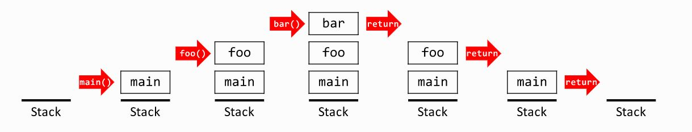

# Функции

## Дефиниция

В контекста на програмирането, функция е именувана група от инструкции, които изпълняват конкретна функционалност.

### Предимства на функциите:
- Модулност - разделяне на кода на логически части
- Преизползваемост - функциите могат да се извикват многократно
- Четимост - кодът е по-ясен и структуриран
- Лесна поддръжка - промените се правят на едно място
- Абстракция - скриване на детайли на имплементацията

## Синтаксис

```c++
<тип_резултат> <идентификатор>(<параметър1>, <параметър2>, ...) {
    <тяло на функцията>
}
```

### Компоненти на функцията:

- `<тип_резултат>` – типът на стойността, която функцията връща, или `void`, ако не връща резултат
- `<идентификатор>` – име на функцията (трябва да е описателно)
- `<параметър>` – всеки параметър се състои от `<тип>` и `<идентификатор>`
- `<тяло>` – блок от код, който се изпълнява при извикване на функцията

> Сигнатура на функция: комбинацията от име и типове на параметрите (без връщания тип).

### Семантични бележки
- `void` - специален тип, означаващ "няма връщана стойност"
- Функция с тип различен от `void` **трябва** да върне стойност чрез `return`, иначе - недефинирано поведение (компилаторът обикновено издава само предупреждение; изключение е `main`, където `return 0` се подразбира)
- При подаване на **примитивен тип** или обект като параметър, се създава **копие** в scope-а на функцията (pass by value)
- Извикването на функция е операция с **много висок приоритет**
- Функциите трябва да бъдат **декларирани или дефинирани преди** да бъдат използвани
- Параметрите на функцията са **локални променливи** с scope само вътре във функцията

### Пример
```c++
#include <iostream>

// Функция без параметри и без връщана стойност
void HelloWorld() {
    std::cout << "Hello World!" << std::endl;
}

// Функция с параметри и връщана стойност
int Add(int a, int b) {
    return a + b;
}

// Функция с параметри без връщана стойност
void PrintNumber(int num) {
    std::cout << "Number: " << num << std::endl;
}

int main() {
    HelloWorld();              // Извикване на функция без параметри
    
    int sum = Add(5, 3);       // Извикване с параметри и запазване на резултата
    std::cout << "Sum: " << sum << std::endl; // Изход: Sum: 8
    
    PrintNumber(42);           // Извикване с параметър
    
    return 0;
}
```

### Оператор return

Функции на `return`:
- Прекратява незабавно изпълнението на функцията.
- Връща стойност на извикващата функция (ако типът не е `void`).
- Може да има **множество `return` изрази** в една функция.

**При void функции:**
```c++
void PrintPositive(int num) {
    if (num <= 0) {
        return; // Ранно приключване, не се изпълнява кода след това
    }
    std::cout << "Positive number: " << num << std::endl;
}
```

**При функции с връщана стойност:**
```c++
int Max(int n, int k) {
    return n > k ? n : k; // Връща по-голямото от двете числа
}

int Absolute(int num) {
    if (num < 0) {
        return -num; // Множество return изрази
    }
    return num;
}

// ЛОШО - код след return никога не се изпълнява!
int Bad() {
    return 5;
    std::cout << "Never printed"; // Unreachable code - предупреждение
}
```

**Важно:**
- Всички пътища на изпълнение в non-void функция **трябва** да завършват с `return`
- Код след `return` **не се изпълнява** (unreachable code)
- `return` без стойност е валиден само за `void` функции

## Параметри по копие (Pass by value)

**По подразбиране, C++ подава аргументи към функции чрез копиране.**

```c++
#include <iostream>

void Increment(int n) {
    n++;                        // Променя се САМО локалното копие
    std::cout << "Inside function: " << n << std::endl; // 5
}

int main() {
    int n = 4;
    std::cout << "Before: " << n << std::endl; // 4
    
    Increment(n);               // Подава се копие на n
    
    std::cout << "After: " << n << std::endl;  // 4 - оригиналът е непроменен!
    
    return 0;
}
```

### Как работи pass by value
- При извикване на функцията се създава копие на аргумента.
- Функцията работи само с копието.
- Промените във функцията НЕ засягат оригиналната променлива.
- След приключване на функцията, копието се унищожава.

## Параметри по референция (Pass by reference)

**Референцията е алтернативно име (псевдоним) на съществуваща променлива.**

Обявява се чрез символа **`&`** след типа на параметъра.

```c++
#include <iostream>

void Increment(int& n) { // & означава референция
    n++;                        // Променя ДИРЕКТНО оригиналната променлива
    std::cout << "Inside function: " << n << std::endl; // 5
}

int main() {
    int n = 4;
    std::cout << "Before: " << n << std::endl; // 4
    
    Increment(n);               // Подава се референция (не копие!)
    
    std::cout << "After: " << n << std::endl;  // 5 - оригиналът Е ПРОМЕНЕН!
    
    return 0;
}
```

**Класически пример - функция Swap:**
```c++
#include <iostream>

void Swap(double& a, double& b) {
    double temp = a;
    a = b;
    b = temp;
}

int main() {
    double x = 3.5, y = 7.2;
    std::cout << "Before: x=" << x << ", y=" << y << std::endl; // x=3.5, y=7.2

    Swap(x, y);

    std::cout << "After: x=" << x << ", y=" << y << std::endl;  // x=7.2, y=3.5

    return 0;
}
```
Ако параметрите бяха по копие (`double a, double b`), функцията щеше да размени само локалните копия и `x` и `y` щяха да останат непроменени. Повече за референциите има в [Тема 5](../Sem.05/README.md).

### Как работи pass by reference
- При извикване **НЕ се създава копие**.
- Функцията получава **директен достъп** до оригиналната променлива.
- Промените във функцията **ЗАСЯГАТ** оригиналната променлива.
- По-ефективно за големи обекти.

### Кога да използваме
- Когато искаме функцията да **модифицира** оригиналната променлива.
- Когато подаваме **големи обекти** и искаме да избегнем копиране.
- Когато функцията трябва да върне **множество стойности** чрез параметрите.

## Function Overloading (Претоварване на функции)

**Overloading** позволява на няколко функции да имат **едно и също име**, но **различни параметри** (брой или тип).

### Как работи 
- Компилаторът избира **правилната версия** на базата на подадените аргументи.
- Може автоматично да прави **type conversion** при нужда.
- Ако **не намери** подходяща версия - **грешка при компилация**.
- Ако намери **повече от 1** подходяща версия - **грешка за ambiguity (двусмислие)**.

### Основни правила
- Функциите трябва да се различават по **брой** и/или **тип** на параметрите
- **Само връщаният тип НЕ е достатъчен** за разграничаване
- Подредбата на параметрите **има значение**
- `const` върху параметър по стойност **не** променя сигнатурата - `F(int)` и `F(const int)` са една и съща функция

**Примери:**

Деветте декларации по-долу не могат да стоят заедно в една програма. `//7` повтаря `//2`, а `//9` се различава от `//1` само по връщания тип. Следващият блок показва кои двойки са грешка и кои са валидно претоварване.

```c++
void Print(char a) { std::cout << a; } //1

void Print(int a) { std::cout << a; } //2

void Print(char a, int b) { std::cout << a << '-' << b; } //3

void Print(double a, char b) { std::cout << b << '-' << a; } //4

void Print(bool a) { std::cout << a; } //5

void Print(char a, bool b, int c) { std::cout << a << b << c; } //6

void Print(const int a) { std::cout << a; } //7

void Print(char a, unsigned b) { std::cout << a << '-' << b; } //8

char Print(char a) { return a; } //9
```

```c++
void Print(char a) { std::cout << a; } // грешка с 9 - различават се само по връщания тип

void Print(int a) { std::cout << a; } // redefinition със 7

void Print(char a, int b) { std::cout << a << '-' << b; } // валиден overload; двусмислие само при извикване като Print('a', 1.5)

/*-------------------------------------------------------*/
void Print(double a, char b) { std::cout << b << '-' << a; }

void Print(bool a) { std::cout << a; }

void Print(char a, bool b, int c) { std::cout << a << b << c; }
/*-------------------------------------------------------*/

void Print(const int a) { std::cout << a; } // redefinition с 2 - const върху параметър по стойност не е част от сигнатурата

void Print(char a, unsigned b) { std::cout << a << '-' << b; } // валиден overload; вж. бележката при 3

char Print(char a) { return a; } // грешка с 1 - различават се само по връщания тип
```

`Print('a', 1.5)`, `Print('a', 1.5f)` и `Print('a', 1L)` са двусмислени между `Print(char, int)` и `Print(char, unsigned)`. Ако в програмата има и `Print(char)`, `Print(int)` и `Print(bool)`, извикването `Print(0.0)` също е двусмислено.

**Важно:**
- Подредбата на параметрите **има значение** - `Func(int, double)` и `Func(double, int)` са **различни** функции
- Overloading прави кода **по-четим** и **по-лесен за използване**
- **Избягвайте** прекалено много overloads - усложнява кода

## Параметри по подразбиране
Възможно е да имате програма, в която 90% от случаите подавате един и същ параметър на дадено място. <br />
C++ позволява да имате стойност по подразбиране за 1 или повече параметри, които не се налага да уточнявате при извикване на функцията. <br />

```c++
#include <iostream>

void Print(int a, int b = 5) {
    std::cout << a << " " << b;
}

int main() {
    Print(4); // 4 5
    Print(3, 6); // 3 6
    
    return 0;
}
```

> **Важно:** Параметрите по подразбиране трябва винаги да са в края!
```c++
#include <iostream>

void Print(int a, int b = 5, char c = 't') {
    std::cout << a << " " << b << " " << c;
}

int main() {
    Print(4); // 4 5 t
    Print(3,6); // 3 6 t
    Print(3, '0'); // 3 48 t
    
    return 0;
}

//‘0’ има стойност 48 в ASCII => компилаторът го разглежда като int със стойност 48
```

> **Важно:** Параметрите по подразбиране винаги са в последователността, в която са дефинирани, не могат да се прескачат

## Function Declaration vs Definition
Declaration – казва на компилатора, че такава функция съществува. <br />
Definition – казва на компилатора, какво всъщност прави тази функция(нейната функционалност). <br />
Една функция **може да бъде декларирана**, но да **не бъде дефинирана**. Получаваме грешка при свързване (linker error), ако тази функция бъде извикана. <br />

```c++
#include <iostream>

//Declaration
void HelloWorld(); 

int main() {
    HelloWorld();
    
    return 0;
}

//Definition
void HelloWorld() {
    std::cout << "Hello World!\n";
}
```

## Стек и Стекова рамка

> Тази тема е въведение и ще бъде разгледана по-подробно по-късно, когато обсъждаме управлението на паметта.

Засега е важно да знаем, че съществува стекова памет (Stack), която обикновено се използва за обслужване на извикванията на функции и съхранение на информация, необходима за тяхното изпълнение.

### Стекова памет (Stack)
Стековата памет работи по принципа LIFO (Last In, First Out) – последното добавено нещо се премахва първо.   
Това означава, че:
- при извикване на функция се запазва необходимата информация за нейното изпълнение.
- при извикване на друга функция се запазва информацията за новото извикване.
- когато извиканата функция приключи, управлението се връща към функцията, която я е извикала.
- при приключване на функцията нейните автоматични локални обекти приключват своя жизнен цикъл.

### Стекова рамка (Stack Frame)
При всяко извикване на функция се създава стекова рамка – логическа област в стека, която съдържа:
- информация за параметрите на функцията.
    - могат да се съхраняват в стековата рамка или в регистрите на процесора.
- адреса, към който програмата трябва да продължи след приключване на функцията (Return Address).
    - при много архитектури се записва в стека, но при други може да се съхранява в специален регистър.
- информация за предишната стекова рамка;
    - може да има запазен указател към предишната рамка, но това не е задължително.
- локални променливи и временни данни, необходими за изпълнението на функцията.
    - могат да бъдат в стека, регистрите или изобщо да бъдат оптимизирани и премахнати.
- (ако има) място за върнатата стойност.
    - върнатата стойност често се предава чрез регистър на процесора или чрез памет, предоставена от извикващата функция.

При приключване на функцията стековата рамка се премахва от стека и управлението се връща към извикващата функция.

Да разгледаме следния пример:
```c++
void Bar() { }

void Foo() {
    Bar();
}

int main() {
    Foo();
}
```
Кои стекови рамки се намират в стека, във всеки един момент на изпълнение на програмата, са показани на долната картинка:   


## Допълнителни ресурси

### Ред на изчисляване при извикване на функция
Редът, в който се изчисляват аргументите на функция, не е определен от стандарта. От C++17 изчисляването на отделните аргументи не се преплита, а изразът, който определя извикваната функция, се изчислява преди тях. При някои оператори редът е гарантиран: `<<` и `>>` се изчисляват отляво надясно, а при `=` дясната страна се изчислява преди лявата.

```c++
#include <iostream>

int Next(int& counter) {
    return ++counter;
}

void Print(int a, int b) {
    std::cout << a << ' ' << b << '\n';
}

int main() {
    int counter = 0;

    Print(Next(counter), Next(counter)); // "1 2" или "2 1" - редът не е определен
    std::cout << Next(counter) << ' ' << Next(counter) << '\n'; // "3 4" - от C++17 редът е гарантиран

    return 0;
}
```

- [SO: What are the evaluation order guarantees introduced by C++17?](https://stackoverflow.com/questions/38501587/what-are-the-evaluation-order-guarantees-introduced-by-c17)
- [Refining Expression Evaluation Order for Idiomatic C++](https://www.open-std.org/jtc1/sc22/wg21/docs/papers/2016/p0145r3.pdf)

## Задачи
1. Напишете функция, която приема неотрицателно число n и връща числото обърнато. <br />
Вход: 288  
Изход: 882

2. Напишете функция, която приема неотрицателно число и връща дали числото е палиндром. <br />
Вход: 2882  
Изход: true

3. Напишете функция, която приема неотрицателно число и връща дали цифрите му са сортирани (във възходящ или в низходящ ред). <br />
Вход: 122239  
Изход: true
