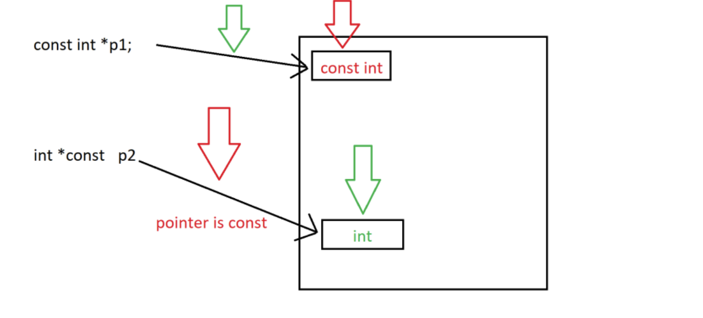
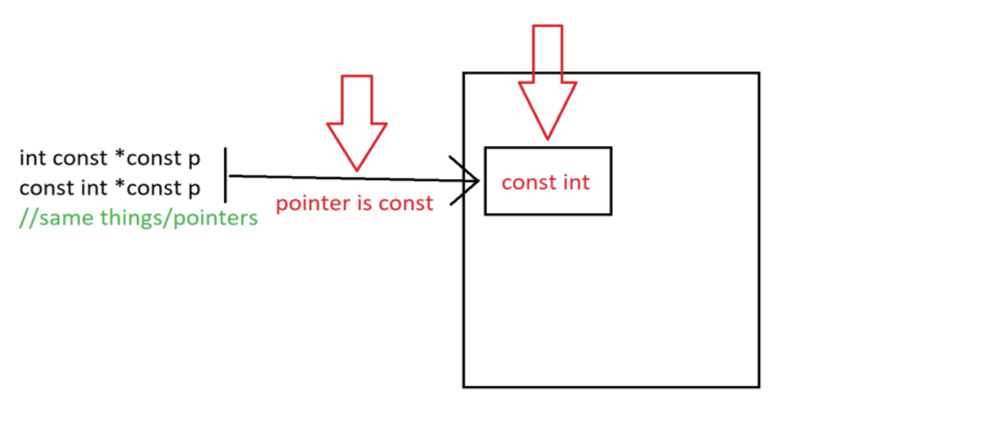

# Референции и указатели

## Референция (Reference)

**Референцията** е **алтернативно име (псевдоним/alias) за съществуваща променлива**.

### Основни характеристики:

- Декларира се чрез оператора `&` след типа.
- Трябва да бъде **инициализирана веднага** при декларация.
- След инициализация **не може да се пренасочи** към друга променлива.
- Неконстантна референция (`int&`) се свързва само с неконстантна променлива от същия тип.
- Константна референция (`const int&`) може да се свърже и с обект от същия тип, и с временен обект. Когато типът се преобразува, например `const double&` от `int`, временният обект е копие.
- Референция към съществуващ обект от същия тип **не копира** данните. Тя е друго име на този обект.
- **Предотвратява копирането** на големи структури от данни.
- **Не може да бъде null** (за разлика от указателите), но става висяща (dangling), ако обектът, към който е свързана, престане да съществува.

### Референция като параметър на функция

**Pass by value (по копие) vs Pass by reference (по референция):**

```c++
void Example1(int a) {
    a += 5; //copy | no modification
}

void Example2(int& a) {
    a += 5; //by reference | modified
}

int main() {
    int x = 5;
    
    std::cout << "Original: " << x << std::endl;     // 5
    
    Example1(x); // Подава се копие на x
    std::cout << "After example1: " << x << std::endl; // 5 (БЕЗ промяна!)
    
    Example2(x); // Подава се референция към x
    std::cout << "After example2: " << x << std::endl; // 10 (С промяна!)
    
    return 0;
}
```

**Какво се случва:**
- В `Example1()` - създава се **копие** на `x`, промените засягат само копието
- В `Example2()` - `a` е **референция** към `x`, промените засягат директно `x`

### Пример: Разлика между копие и референция

```c++
// Пример: БЕЗ референция (създават се копия)
unsigned int familyMoney = 100;
unsigned int momMoney = familyMoney;    // Копие на стойността
unsigned int fatherMoney = familyMoney; // Друго копие

momMoney -= 30; // Променя само momMoney

std::cout << "Mom: " << momMoney << ", Father: " << fatherMoney << std::endl;
// Изход: Mom: 70, Father: 100 (fatherMoney НЕ е засегнато)
```

```c++
// Пример: С референция (споделен достъп)
unsigned int familyMoney = 100;
unsigned int& momMoney = familyMoney;    // Референция към familyMoney
unsigned int& fatherMoney = familyMoney; // Друга референция към същото

momMoney -= 30; // Променя familyMoney директно

std::cout << "Mom: " << momMoney << ", Father: " << fatherMoney << std::endl;
// Изход: Mom: 70, Father: 70 (и двете са референции към familyMoney)

std::cout << "Family: " << familyMoney << std::endl; // 70
```

**Обяснение:**
- Без референция: всяка променлива има **своя копие** на данните
- С референция: всички променливи сочат към **едни и същи данни** в паметта

### Класически пример: Функция Swap

- Swap (по копие):
```c++
void Swap(double a, double b) { // Параметри по копие
    double temp = a;
    a = b;
    b = temp;
    // Разменят се САМО локалните копия!
}

int main() {
    double x = 3.5, y = 7.2;
    std::cout << "Before: x=" << x << ", y=" << y << std::endl; // 3.5, 7.2
    
    Swap(x, y); // Нищо няма да се случи!
    
    std::cout << "After: x=" << x << ", y=" << y << std::endl;  // 3.5, 7.2
    // x и y НЕ СА разменени, защото функцията работи с копия!
    return 0;
}
```

- Swap (по референция):
```c++
void Swap(double& a, double& b) { // Параметри по референция
    double temp = a;
    a = b;
    b = temp;
    // Разменят се оригиналните променливи!
}

int main() {
    double x = 3.5, y = 7.2;
    std::cout << "Before: x=" << x << ", y=" << y << std::endl; // 3.5, 7.2
    
    Swap(x, y); // Работи!
    
    std::cout << "After: x=" << x << ", y=" << y << std::endl;  // 7.2, 3.5
    // x и y СА разменени успешно!
    return 0;
}
```

### Функция връщаща референция
- когато връщате референция, Вие не връщате стойността на променливата, а цялата променлива.
- трябва да сте сигурни, че променливата, чиято референция връщате, **съществува и след приключването на функцията**, тоест **не връщате локално създаден обект**.

```c++
int& ErrorProne() {
    int a = 5;
    return a;
}
// Недефинирано поведение, ако извикващият използва върнатата референция.
// a вече не съществува. Програмата може да отпечата 5, докато тази памет
// не е преизползвана, но резултатът не е дефиниран.
```

## Указател

- Указателят е променлива, чиято стойност е адрес в паметта.
- Типът `int*` означава „указател към `int`“. Той е различен от типа `int`, към който сочи.
- Адресът на обект се получава с `&` и се записва в указателя: `int* ptr = &number`. 

```c++
int number = 5;
int* ptr = &number; // ptr съхранява адреса на number

std::cout << "Value of number: " << number << std::endl;        // 5
std::cout << "Address of number: " << &number << std::endl;     // 0x... (адрес)
std::cout << "Value of ptr: " << ptr << std::endl;              // 0x... (същият адрес)
std::cout << "Value at address ptr: " << *ptr << std::endl;     // 5 (дереференция)

*ptr = 10; // Променя number чрез указателя
std::cout << "New value of number: " << number << std::endl;    // 10
```

### Работа с указатели - Стъпка по стъпка

```c++
    //create pointer and set it to address of variable
    bool* engineer = nullptr; 
    bool plane1 = true;
    engineer = &plane1;

    //create another pointer and set it to point to the same address as the first pointer
    bool* gremlin = engineer;

    //set the value to false through the second pointer
    *gremlin = false;

    //set the value to true
    *engineer = true;

    //set value
    bool plane2 = *engineer;
    *gremlin = false;

    //set pointer to plane2's address
    gremlin = &plane2;

    //set value
    *engineer = 1;

    //set gremlin's value to opposite of engineer's value
    *gremlin = !(*engineer);
```

> Бележка: В по-стара версия на примера стъпката беше `(*gremlin)--;`. Операторът `--` върху `bool` никога не е бил позволен в C++, а `++` върху `bool` беше обявен за остарял (deprecated) и е премахнат от C++17. Причината е, че `bool` има само две стойности: `b++` винаги дава `true` и е по-неясен запис на `b = true`, а `b--` няма смислен резултат. Затова присвояваме стойността директно: `*gremlin = false;`.

### Nullptr
- pointer literal(пойнтеров литерал) от тип `std::nullptr_t`.
- може да се преобразува до всеки тип указател.
    - резултатът е нулев указател (null pointer), който не сочи към никакъв обект.
- не може да се вземе адреса му с `&`.
- дерефериране на нулев указател е недефинирано поведение.
- Нулевият указател не сочи към обект. Не го отъждествявайте с адреса `0x00000000`: битовото му представяне зависи от платформата.

```c++
// function with integer argument
void Fun(int n) {
    std::cout << "Fun(int)\n";
}

// Overloaded function with char pointer argument
void Fun(char* s) {
    std::cout << "Fun(char*)\n";
}

int main() {
    Fun(NULL);    // зависи от компилатора: при GCC/Clang обикновено е ambiguous, при MSVC извиква Fun(int)
    Fun(nullptr); // винаги извиква Fun(char*)
}
```

### Указатели към константи и константни указатели

`const int*` и `int const*` са един и същ тип: указател към константен `int`.
- През такъв указател не може да се присвоява: `*p = 3` е грешка.
- Самият указател може да бъде пренасочен към друг обект.
- Ако обектът не е константа, той пак може да се промени през собственото си име.

`int* const` е константен указател към променлив `int`.
- Стойността, към която сочи, може да се променя: `*q = 5` е позволено.
- Указателят не може да бъде пренасочен.
- Може да бъде нулев: `int* const q = nullptr`.



`const int* const` е константен указател към константен `int`. Забранени са и присвояването през указателя, и пренасочването му. `const int* const` и `int const* const` са един и същ тип.



### Spiral Rule - David Anderson

Четенето започва от **името** на променливата и върви навън: първо надясно, после наляво. Скобите сменят този ред. Следните декларации са валиден C++.


```c++
const int* const value = nullptr;           // константен указател към константен int
int const* const same = nullptr;            // същият тип като value
int** const pointer = nullptr;              // константен указател към указател към int
int* const* toConstPointer = nullptr;       // указател към константен указател към int
const int** toConstInt = nullptr;           // указател към указател към константен int
int* const* const both = nullptr;           // константен указател към константен указател към int
const int* const* const allConst = nullptr; // константен указател към константен указател към константен int
```

## Допълнителна информация

### x86 (32-bit) vs x64 (64-bit)

- **x86** (32-битова архитектура) - адресът е 32 бита, указателят заема **4 байта** и програмата може да адресира най-много 2³² байта = **4 GB** памет.
- **x64** (x86-64, 64-битова архитектура) - адресът е 64 бита, указателят заема **8 байта**. Теоретично това са 2⁶⁴ байта (16 EB), но процесорът и операционната система ограничават използваната памет до много по-малко.
- **x32** не е 32-битовата архитектура: така се нарича рядко използван режим на x64 с 4-байтови указатели. За 32-битовата архитектура казваме x86.

**В: Заема ли референцията памет? Каква е разликата между референция и константен указател?** <br />
О: Референцията обикновено не заема допълнителна памет в повечето случаи - тя е просто псевдоним (alias) за съществуваща променлива. Компилаторът я третира като директен достъп до оригиналната променлива. Въпреки това, в някои случаи (особено когато се връща референция от функция или се съхранява в клас), компилаторът може да я имплементира вътрешно като указател.

Разлики между референция и константен указател (`int* const`):
- Референцията **трябва** да се инициализира при декларация и не може да се пренасочи към друга променлива.
- Константният указател също не може да се пренасочи и също **трябва** да се инициализира при декларация.
- Референцията използва по-прост синтаксис (не се нуждае от `*` за дереференция).
- Константният указател може да бъде `nullptr`, докато референцията винаги трябва да сочи към валиден обект.
- Референцията е по-безопасна, тъй като не може да бъде null.

**В: Защо указателите са 4 байта или 8 байта в зависимост от архитектурата?** <br />
О: Указателят съхранява адрес, затова размерът му е размерът на адреса: **4 байта** при x86 и **8 байта** при x64. Размерът е един и същ за `int*`, `char*` и `double*`, защото не зависи от типа, към който указателят сочи.

## Задачи

### Референции

**1.**  Да се напише функция *Swap*, която приема 2 числа и разменя стойностите им. <br />
  Вход: 5 7  | Изход: 7 5 <br />

**2.** Да се напишат функции <br />
- *ToUpper*, която приема буква и я превръща в съответстващата й голяма; <br />
- *ToLower*, която приема буква и я превръща в съответстващата й малка. <br />

**3.** Да се напише функция *Sort3(int& min, int& mid, int& max)*, която приема 3 числа и ги сортира във възходящ ред.

  Вход: 4 5 3  | Изход: 3 4 5 <br />

**4.** Да се напише функция, която приема 2 числа - числител и знаменател на обикновена дроб, и съкращава дробта. Напишете програма, която извежда сбора на 2 такива дробни числа.<br />

  **Ограничения:** числителите и знаменателите са цели числа, по абсолютна стойност не по-големи от 10^9, а знаменателите са различни от 0. <br />

### Указатели

**1.** Дадени са два указателя към цели числа. Напишете функция, която разменя това, към което сочат указателите —
т.е. след извикването ѝ първият указател трябва да сочи към променливата, към която е сочил вторият, и обратно.

**2.** Напишете функция, която приема две числа и връща указател към променливата с по-голяма стойност.
