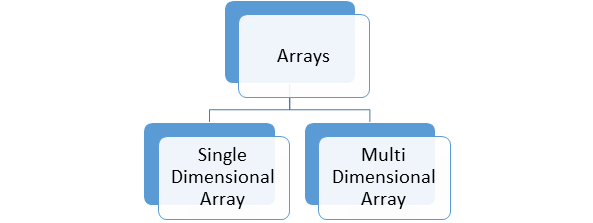
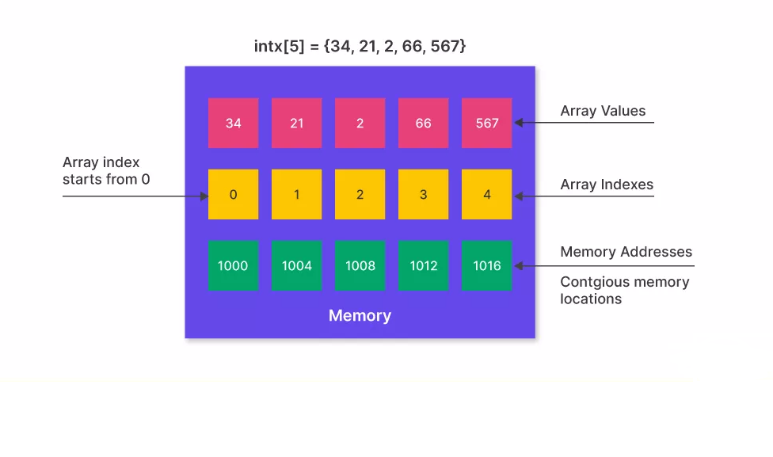

# Масиви (Arrays)

## Дефиниция

**Масив** е **наредена последователност от елементи от един и същи тип**, съхранявани в **последователни области на паметта**.

### Основни характеристики:
- Всички елементи са от **еднакъв тип**.
- Елементите са разположени **последователно в паметта**.
- **Фиксиран размер** - определя се при декларация и не може да се променя.
- **Индексация започва от 0** - първият елемент е на индекс 0.
- **Константен достъп** - достъп до всеки елемент за O(1) време.
- Името на масива се **преобразува до указател към първия елемент**, когато го използваме в израз или го подаваме на функция.

## Синтаксис

```c++
<тип> <име>[<размер>];
```

### Компоненти
- `<тип>` - типът на елементите в масива (`int`, `double`, `char` и т.н.)
- `<име>` - идентификатор на масива (трябва да е описателен)
- `<размер>` - брой елементи (трябва да е **константа**, известна при компилация)



## Инициализация на масиви

```c++
int arr[5]; // Създава масив от 5 цели числа. Локалният масив съдържа случайни (неинициализирани) стойности.
int arr2[] = {34, 21, 2, 66, 567}; // Създава масив от 5 елемента.
int arr3[5] = {1, 2, 3}; // Останалите елементи се запълват с 0: {1, 2, 3, 0, 0}
int arr4[5] = {}; // Всички елементи са 0.
int arr5[]; // грешка - няма нито размер, нито стойности
int arr6[4] = {1, 2, 3, 4, 5}; // грешка - стойностите са повече от размера
```

Задължително големината на масива трябва да е константа, чиято стойност е ясна преди да се компилира програмата.

```c++
int n;
std::cin >> n;
int arr[n]; // грешка!
```

> GCC и Clang приемат `int arr[n]` като разширение на езика (variable length array), но това **не е** стандартен C++. Visual Studio дава грешка при компилация, затова не използваме този запис.

```c++
const int SIZE = 4;
int arr[SIZE]; //ok!
```



## Достъп на елемент
- В масивите имаме константен достъп до всеки един елемент. <br />
- Достъпът става посредством индекси. Индексацията започва от 0. <br />
```c++
int arr[] = {1, 2, 400, 4, 5};

arr[3] = 44; // Присвоява на елемента на индекс 3 стойността 44.
             // [1, 2, 400, 44, 5]

std::cout << arr[2]; // Отпечатва на стандартния изход елемента на индекс 2 (400)
```

Когато използваме `arr` в израз, то се преобразува до **указател към първия елемент**.
```c++
int arr[] = {1, 2, 400, 4, 5};
std::cout << arr; // Ще се отпечата АДРЕСЪТ на масива, а не самият масив.
```
- Достъпът до елемент става чрез изчисляване на адреса му.
- `arr[i]` е същото като `*(arr + i)` - `i` е броят "отмествания" надясно от първия елемент.
- В байтове адресът на `arr[i]` е: адресът на `arr` + `i * sizeof(int)`. При `arr + i` компилаторът сам умножава по размера на елемента.

Масивът **не е** указател. Разликата се вижда при `sizeof`:
```c++
int arr[] = {1, 2, 400, 4, 5};
int size = sizeof(arr) / sizeof(arr[0]); // 20 / 4 = 5 елемента
```
Този начин работи само там, където е деклариран масивът. Във функция параметърът `int arr[]` всъщност е указател, затова `sizeof(arr)` връща размера на указателя (например 8 байта), а не на масива. Затова подаваме размера като отделен параметър.

## Подаване на масиви във функции
```c++
#include <iostream>

void Print(const int arr[], int size) {
    for (int i = 0; i < size; i++) {
        std::cout << arr[i] << " ";
    }
    std::cout << std::endl;
}

void Increment(int arr[], int size) {
    for (int i = 0; i < size; i++) {
        arr[i]++;
    }
}

int main() {
    const int SIZE = 4;
    int arr[SIZE]{ 1, 2, 3, 4 };

    Increment(arr, SIZE);
    Print(arr, SIZE); // 2 3 4 5

    return 0;
}
```

Записите `int arr[]` и `int* arr` като параметър на функция са еквивалентни - и в двата случая функцията получава указател към първия елемент.

```c++
#include <iostream>

void Print(const int* arr, int size) {
    for (int i = 0; i < size; i++) {
        std::cout << arr[i] << " ";
    }
    std::cout << std::endl;
}

void Increment(int* arr, int size) {
    for (int i = 0; i < size; i++) {
        arr[i]++;
    }
}

int main() {
    const int SIZE = 4;
    int arr[SIZE]{ 1, 2, 3, 4 };

    Increment(arr, SIZE);
    Print(arr, SIZE); // 2 3 4 5

    return 0;
}
```
Масивите се подават във функциите по адрес!  <br />
Т.е промените, които се правят върху масива във функцията, ще се отразят върху подадения като параметър масив! <br />

### Двумерни масиви
```c++
int matrix1[3][4]; // създава се матрица с 3 реда и 4 колони

int matrix2[3][3] = { { 1, 2, 3}, { 4, 5, 6 }, {7, 8, 9} }; // изреждаме редовете

int matrix3[3][4] = { 1, 2, 3, 4, 9, 8, 7, 6, 11, 12, 13, 14 }; // изреждаме елементите

int matrix4[][4] = { 1, 2, 3, 4, 9, 8, 7, 6, 11, 12, 13, 14 }; // можем да изпуснем най-лявата спецификация на дължина

```


### Достъп до елемент.
```c++
int matrix4[][4] = { 1, 2, 3, 4, 9, 8, 7, 6, 11, 12, 13, 14 };

int* row = matrix4[1]; //ред 1 (масивът на индекс 1)

std::cout << matrix4[2][0]<< std::endl; //11

std::cout << row[2]<< std::endl; //7
```

### Примери с n-мерни масиви.

```c++
int cube[3][3][3]; // създава се тримерен масив  
```

### Достъп до елемент.

```c++
cube[2]       // двумерен масив (3x3 матрица в нашия случай);
cube[2][1]    // едномерен масив (ред с 3 елемента);
cube[2][1][0] // конкретен елемент (индекс 0 от реда);
```


## Задачи

Решенията са в [`01-Solutions`](01-Solutions).

- Въвеждане и отпечатване на масив. ([Task 01](01-Solutions/Task01.cpp))
- Линейно търсене в масив. ([Task 02](01-Solutions/Task02.cpp))
- Обръщане на масив. ([Task 03](01-Solutions/Task03.cpp))
- Сортиране по метода на мехурчето (Bubble Sort). ([Task 04](01-Solutions/Task04.cpp))
- Двоично търсене в сортиран масив. ([Task 05](01-Solutions/Task05.cpp))
- Всички прости числа до n чрез [решето на Ератостен](https://bg.wikipedia.org/wiki/Решето_на_Ератостен). ([Task 06](01-Solutions/Task06.cpp))
