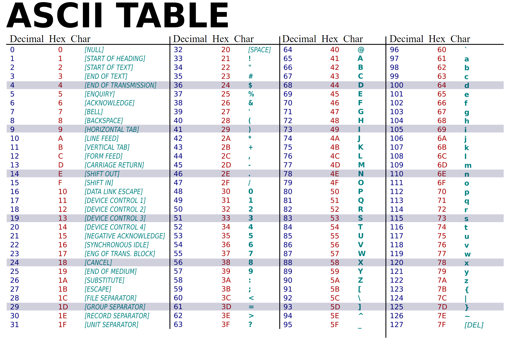

# Символни низове

## ASCII таблица - история и обяснение

### История на ASCII
- **ASCII** (American Standard Code for Information Interchange) е създаден през 1963 година.
- Разработен е от American Standards Association (сега ANSI).
- Целта е била да се създаде стандарт за представяне на текст в компютрите и телекомуникационното оборудване.
- Първоначално използва **7 бита** (128 символа), по-късно се появяват множество **8-битови** разширени кодови таблици, често наричани **Extended ASCII**, но те не са част от официалния ASCII стандарт.

### Структура на ASCII таблицата



ASCII таблицата е разделена на няколко основни групи:

#### Контролни символи (0-31 и 127)
- Специални символи за управление на текстов поток
- Примери:
  - `'\0'` (NUL) - код 0 - терминираща нула
  - `'\t'` (Tab) - код 9 - табулация
  - `'\n'` (Line Feed) - код 10 - нов ред
  - `'\r'` (Carriage Return) - код 13 - връщане в началото на реда
  - DEL - код 127 - последният символ в таблицата също е контролен

#### Печатни символи (32-126)
- Интервал - (код 32)
- Цифровите символи `0`-`9` са последователни в ASCII (кодове 48-57)
- Букви:
    - Главните букви `A`-`Z` са последователни (кодове 65-90)
    - Малките букви `a`-`z` са последователни (кодове 97-122)
    - Разликата между главна и малка буква е **32** (или 2^5)
- Специални символи: `!`, `@`, `#`, `$`, `%`, `^`, `&`, `*`, и др.

#### Кодове над 127
- ASCII свършва при 127. Кодовете 128-255 се използват от различни 8-битови кодови таблици (Extended ASCII), например Windows-1251 за кирилица, и значението им зависи от таблицата.
- Стандартът не уточнява дали `char` е знаков тип. Във Visual Studio и в GCC/Clang за x86 той е знаков (signed), затова символ с код над 127 има **отрицателна** стойност (от -128 до -1). Повече за това има в раздела „Кирилица и символи извън ASCII“ по-долу.

### Символите са числа

```c++
char letter = 'A';
int code = static_cast<int>(letter); // code = 65

char digit = '5';
int value = digit - '0'; // value = 5 (защото '5' има код 53, '0' - код 48)

// Проверка дали символ е главна буква
bool isUpperCase = letter >= 'A' && letter <= 'Z';

// Проверка дали символ е цифра
bool isDigit = digit >= '0' && digit <= '9';

// Преобразуване на главна буква в малка - само ако символът наистина е главна буква
if (isUpperCase) {
    letter = letter + ('a' - 'A'); // или letter + 32
}
```

Аритметиката със символи дава `int`, затова резултатът се отпечатва като число:

```c++
char letter = 'A';
std::cout << letter + 32 << std::endl;                    // 97
std::cout << static_cast<char>(letter + 32) << std::endl; // a
```

## Определение
- Символен низ наричаме **последователност от символи**.
- Последователност от 0 символи наричаме **празен низ**.
- Представяне в C++ - масив от символи (`char`), който завършва със специалния символ `'\0'` (терминираща нула).

### Терминираща нула - `'\0'`
- Първият символ в ASCII таблицата, с код 0 – т.е. **char(0)**.
- Брои се като елемент и **влияе** на размера на масива, но **не** е част от дължината на низа.
- Използва се като **прекъсвач (терминатор)** от много функции за символни низове, за да се определя краят на низа.

```c++
// Може да се сложи в средата на масив от символи
char a[] = {'H', 'e', 'l', 'l', '\0', 'o'}; // символният низ е "Hell"
```

Следните записи изглеждат подобно, но са различни:

| Запис | Какво е | Съдържание |
|---|---|---|
| `'\0'` | символ (`char`) | код 0 - терминираща нула |
| `'0'` | символ (`char`) | код 48 - цифрата нула |
| `"0"` | низ (`const char[2]`) | `'0'` и `'\0'` |
| `nullptr` | нулев указател | не сочи към нищо и не е символ |

- Аналогично `'a'` е един символ (`char`), а `"a"` е низ от два елемента: `'a'` и `'\0'`.
- Името на символа с код 0 в ASCII е **NUL** (с едно L). `NULL` е макросът за нулев указател от Sem.05 и не се използва вместо `'\0'`.

## Инициализация на символни низове

- Чрез инициализатор
```c++
char text[16] = {'C', '+', '+', '\0'};
char sameText[] = {'C', '+', '+', '\0'};
```

- Чрез литерал
    - Литерал е константна стойност, зададена директно в кода, например `5`, `'a'` или `"C++"`.
    - Низовият литерал `"C++"` е масив от тип `const char[4]`: компилаторът сам добавя `'\0'` в края.
```c++
char sameTextAgain[] = "C++";      // масив от 4 елемента: 'C', '+', '+', '\0'
char sameTextYetAgain[16] = "C++"; // останалите елементи са '\0'
```

- Когато в масива няма място за `'\0'`
```c++
char word1[6] = {'H', 'e', 'l', 'l', 'o'}; // низ - шестият елемент се нулира, както при int arr[5] = {1, 2, 3} от Sem.06
char word2[5] = {'H', 'e', 'l', 'l', 'o'}; // обикновен масив от символи, а НЕ низ - няма '\0'
char word3[6] = "Hello";                   // валидно - "Hello" заема 6 елемента
char word4[5] = "Hello";                   // грешка при компилация - няма място за '\0'
```
- `word2` не може да се използва като низ. `std::cout << word2` или функция като `strlen` продължават да четат след края на масива, докато не срещнат случайна `'\0'` - undefined behavior.
- В езика C записът на `word4` е позволен (тогава `'\0'` просто не се записва), но в C++ е грешка.

- Празен низ
```c++
char text1[100] = "";  // всички елементи стават '\0'
char text2[100] = {0}; // явно задаваме първия елемент, а останалите се нулират (работи и в C)
char text3[100] {};    // brace инициализация (C++11 и по-нови) - всички елементи стават '\0'

char text4[100];
text4[0] = '\0';       // това не е инициализация, а присвояване: text4 вече е празен низ,
                       // но останалите 99 елемента продължават да съдържат случайни стойности
```

- Неинициализиран локален масив
```c++
char text[100];    // локалният масив съдържа случайни стойности от паметта!

std::cout << text; // може да изпише боклук, докато не срещне случайна '\0',
                   // или да продължи извън масива - undefined behavior!
```

### Масивите не могат да се присвояват

```c++
char text[10] = "Hello"; // валидно - това е инициализация
```
- Първите 6 елемента съдържат `'H'`, `'e'`, `'l'`, `'l'`, `'o'`, `'\0'`.
- Останалите 4 елемента се нулират автоматично.

```c++
char text[10];
text = "Hello"; // грешка при компилация
```
- `text` е променлива от тип `char[10]`, а масив не може да се присвоява като цяло (същото важи и за масивите от Sem.06).
- Когато използваме `text` в израз, името се преобразува до указател към първия елемент. Масивът обаче **не е** указател и не може да се „пренасочи“ към друг низ.
- За да запишем нов низ в съществуващ масив, копираме символите един по един. Това прави функцията `strcpy` (задача 3).

### Масив или указател към литерал

```c++
char modifiable[] = "Hello";   // масив от 6 елемента - копие на литерала
modifiable[0] = 'J';           // ok: "Jello"

const char* literal = "Hello"; // указател към самия литерал, който е само за четене
// literal[0] = 'J';           // грешка при компилация - literal сочи към const char

// char* wrong = "Hello";      // невалидно от C++11 насам - литералът е const char[6]
```
- В по-старите версии на C++ `char* wrong = "Hello";` е позволено, но промяна на литерала през такъв указател е undefined behavior. От C++11 записът е невалиден: Visual Studio с `/permissive-` (включено по подразбиране в новите проекти) дава грешка, а GCC и Clang - предупреждение.

## Дължина на низ и размер на масив

```c++
#include <cstring> // std::strlen

char text[100] = "Hello";

std::cout << sizeof(text) << std::endl;      // 100 - размер на масива
std::cout << std::strlen(text) << std::endl; // 5 - брой символи преди '\0'
std::cout << sizeof("Hello") << std::endl;   // 6 - литералът включва и '\0'
```
- `sizeof` дава размера на масива и се знае по време на компилация. Дължината на низа се изчислява по време на изпълнение, като се броят символите до `'\0'`.
- Във функция параметърът `char str[]` е указател, затова `sizeof(str)` връща размера на указателя (например 8), а не на масива (вж. Sem.06).

## Въвеждане на символни низове

### Екстракция с оператор >> (cin >>)

**Характеристики:**
- Чете **само до първия whitespace** (интервал, таб, нов ред)
- **Пропуска** водещи whitespace символи
- **Автоматично добавя** `'\0'` в края (когато чете в `char[]`)
- До C++17 **не проверява** размера на масива - **опасност от buffer overflow**! От C++20 проверява (вж. по-долу).

```c++
char name[10];
std::cout << "Enter name: ";
std::cin >> name; // Ако въведем "John Doe", ще прочете само "John"
```

**Проблем с препълване на буфера (до C++17):**
```c++
char small[5];

// Опасно - buffer overflow:
std::cin >> small; // Ако въведем "HelloWorld", ще се запише извън масива!
                   // Това е undefined behavior и може да срине програмата
```

**Промяна в C++20:** операторът `>>` вече приема масив (`char (&)[N]`), а не указател, и сам чете най-много N-1 символа. Със същия вход `small` съдържа `"Hell"`, а `"oWorld"` остава в потока за следващото четене. Четене в указател (`char* pointer; std::cin >> pointer;`) вече не се компилира.

Visual Studio по подразбиране компилира с C++14, затова не разчитайте на тази защита и ограничавайте входа сами.

**Защита с ограничаване на входа:**
```c++
#include <iomanip> // std::setw

char name[10];

std::cin.width(10); // Ограничава входа до 9 символа (10-1 за '\0')
std::cin >> name;   // Сигурно четене (width важи само за това извличане)

// Алтернативен синтаксис:
std::cin >> std::setw(10) >> name;
```
- Ако думата е по-дълга, се прочитат първите 9 символа, а останалите остават в потока за следващото четене.

### Четене на цял ред - cin.getline()

**Характеристики:**
- Чете **цял ред включително интервали**;
- Спира при достигане на delimiter (по подразбиране `'\n'`);
- **Автоматично добавя** `'\0'` в края;
- **Премахва** delimiter символа от потока (но не го записва);
- **Има вградена защита** - параметърът за размер предпазва от overflow;
- Ако редът е по-дълъг, записва първите size-1 символа, а потокът минава в състояние на грешка (failbit). Всички следващи четения се провалят, докато не извикаме `std::cin.clear()` (вж. примера по-долу).

```c++
char text[100];
std::cin.getline(text, 100); // Чете до 99 символа (100-1 за '\0')
```

**Синтаксис:**
```c++
// buffer    - масивът, където се записва входа
// size      - максимален брой символи за четене (включително '\0')
// delimiter - символ, при който да спре (по подразбиране '\n')
std::cin.getline(buffer, size, delimiter);
```

**Примери с различни delimiters:**
```c++
char data[50];
// Четене до запетая вместо до нов ред
std::cin.getline(data, 50, ',');

// Четене до точка
std::cin.getline(data, 50, '.');
```

### Проблем със смесване на >> и getline()

**Често срещан bug:**
```c++
int age;
char name[50];

std::cout << "Enter age: ";
std::cin >> age;            // Потребителят въвежда "25" и натиска Enter
                            // '\n' остава в буфера!

std::cout << "Enter name: ";
std::cin.getline(name, 50); // Веднага чете оставащия '\n' и приключва!
                            // name остава празен!
```

**Решение:**
```c++
int age;
char name[50];

std::cout << "Enter age: ";
std::cin >> age;
std::cin.ignore(1000, '\n'); // Изчиства всичко до края на реда, включително '\n'

std::cout << "Enter name: ";
std::cin.getline(name, 50); // Сега работи правилно!
```
- `std::cin.ignore()` без аргументи премахва **само един** символ. Ако след числото има интервали (`"25   "`), се премахва само първият интервал и `name` получава останалите интервали вместо следващия ред.

**Helper функция за изчистване на буфера:**
```c++
void ClearInputBuffer() {
    std::cin.clear();             // изчиства error flags
    std::cin.ignore(10000, '\n'); // премахва остатъка от реда
}
```

Числото 10000 е условно „голямо“ и при учебни примери покрива дължината на реда. Стандартът третира `std::numeric_limits<std::streamsize>::max()` като „без ограничение“, затова в професионален код се използва то:

```c++
#include <limits>

void ClearInputBuffer() {
    std::cin.clear();
    std::cin.ignore(std::numeric_limits<std::streamsize>::max(), '\n');
}
```

### Пример: Сигурно четене с валидация

```c++
#include <iostream>
#include <limits>

const int kMaxSize = 100;

int main() {
    char input[kMaxSize] = ""; // Инициализираме с празен низ

    std::cout << "Enter text: ";
    std::cin.getline(input, kMaxSize);

    // Проверка дали входът е успешен
    if (std::cin.fail()) {
        std::cout << "Input too long or error occurred!" << std::endl;
        std::cin.clear(); // Изчиства error флаговете
        std::cin.ignore(std::numeric_limits<std::streamsize>::max(), '\n'); // Изчиства остатъка от реда
    } else {
        std::cout << "You entered: " << input << std::endl;
    }

    return 0;
}
```

## Извеждане на символни низове

`std::cout` има специален вариант за `char*` и `const char*`: отпечатва символите до `'\0'`, а не адреса. Масивите от Sem.06 се отпечатват като адрес.

```c++
int numbers[] = {1, 2, 3};
char text[] = "Hello";

std::cout << numbers << std::endl;                        // адрес, например 0x7ffd5a3c
std::cout << text << std::endl;                           // Hello
std::cout << static_cast<const void*>(text) << std::endl; // адресът на text
```
- Затова масив без `'\0'` (като `word2` по-горе) не се отпечатва с `std::cout <<`.

## Обхождане на символен низ
- Пример с масив:
```c++
for (int i = 0; text[i] != '\0'; i++) {
    std::cout << text[i];
}
```
- Пример с указател:
```c++
const char* p = text;
while (*p != '\0') {
    std::cout << *p;
    p++;
}
```
- Не извиквайте `strlen` в условието на цикъла. Тя обхожда целия низ при всяка проверка, така че цикълът става O(n^2). Обхождайте до `'\0'` или изчислете дължината веднъж преди цикъла.
```c++
for (std::size_t i = 0; i < std::strlen(text); i++) { // лошо - O(n^2)
    // ...
}
```

## Символни низове като параметри на функции
- Низ се подава на функция като указател към първия символ, както всеки масив (Sem.06).
- За разлика от масивите в Sem.06, **размерът не се подава** - функцията намира края на низа по `'\0'`.
- Когато функцията само чете низа, параметърът е `const char*` (или `const char str[]`). Тогава функцията може да се извика и с литерал.

```c++
#include <iostream>

int CountSpaces(const char* str) {
    int count = 0;

    for (int i = 0; str[i] != '\0'; i++) {
        if (str[i] == ' ') {
            count++;
        }
    }

    return count;
}

void ToUpper(char* str) {
    for (int i = 0; str[i] != '\0'; i++) {
        if (str[i] >= 'a' && str[i] <= 'z') {
            str[i] = str[i] - ('a' - 'A');
        }
    }
}

int main() {
    char text[] = "Hello my friend";

    std::cout << CountSpaces(text) << std::endl;      // 2
    std::cout << CountSpaces("a b c d") << std::endl; // 3 - литералът е const char[8]

    ToUpper(text);
    std::cout << text << std::endl; // HELLO MY FRIEND

    return 0;
}
```
- `ToUpper("hello")` е невалидно: литералът е константен и не може да се подаде като `char*` (Visual Studio дава грешка, а GCC и Clang - предупреждение). Ако програмата все пак се компилира, промяната на литерала е undefined behavior.
- Функция не може да върне масив. Когато трябва да създаде нов низ, тя го записва в масив, който получава като параметър (вж. задача 4 - strcat). Не връщайте указател към локален масив - той престава да съществува, когато функцията приключи.

## Сравнение на символни низове

```c++
char first[] = "Hello";
char second[] = "Hello";

if (first == second) { // сравнява АДРЕСИТЕ на двата масива - винаги false
    // ...
}

if (std::strcmp(first, second) == 0) { // сравнява символите - true
    // ...
}
```
- `==`, `<` и `>` между два низа сравняват указатели, а не съдържанието им. GCC и Clang предупреждават за това, а от C++20 сравнението на два масива е deprecated.
- Лексикографското сравнение (по кодовете в ASCII таблицата) се прави с функцията `strcmp` (задача 2). Всички главни букви са преди малките, затова `"Zebra"` < `"apple"`.

## Стандартни функции за символи и низове

В курса реализираме тези функции сами (вж. задачите). Стандартните им варианти са:

| Функция | Header | Какво прави |
|---|---|---|
| `std::strlen(str)` | `<cstring>` | дължина на низа (без `'\0'`) |
| `std::strcpy(dest, src)` | `<cstring>` | копира `src` в `dest` |
| `std::strcat(dest, src)` | `<cstring>` | добавя `src` в края на `dest` |
| `std::strcmp(a, b)` | `<cstring>` | отрицателно число, 0 или положително число според лексикографската наредба |
| `std::strchr(str, c)` | `<cstring>` | указател към първото срещане на `c` или `nullptr` |
| `std::strstr(text, word)` | `<cstring>` | указател към първото срещане на `word` или `nullptr` |
| `std::isdigit(c)`, `std::isalpha(c)` | `<cctype>` | дали символът е цифра / буква |
| `std::isupper(c)`, `std::islower(c)` | `<cctype>` | дали символът е главна / малка буква |
| `std::toupper(c)`, `std::tolower(c)` | `<cctype>` | съответната главна / малка буква |
| `std::atoi(str)` | `<cstdlib>` | преобразува низ в `int` |

- `strcpy` и `strcat` не знаят колко място има в `dest`. Програмистът отговаря `dest` да е достатъчно голям.
- Visual Studio маркира `strcpy`, `strcat` и подобните им функции като небезопасни (предупреждение C4996, а при включени SDL checks - грешка) и предлага `strcpy_s`. За да ги използвате, добавете `#define _CRT_SECURE_NO_WARNINGS` преди всички `#include` директиви.
- Функциите от `<cctype>` очакват стойност на `unsigned char`. Подаване на отрицателен `char` (например буква на кирилица) е undefined behavior.

## Кирилица и символи извън ASCII
- `char` е 1 байт и има само 256 възможни стойности, а кирилицата не е част от ASCII.
- Повечето редактори (и GitHub) записват файловете в UTF-8. В UTF-8 всяка буква на кирилица заема **2 байта**, т.е. 2 елемента `char`:
```c++
std::cout << std::strlen("Hello") << std::endl;   // 5
std::cout << std::strlen("Здравей") << std::endl; // 14, а не 7
```
- `char letter = 'Ж';` не работи: в UTF-8 буквата е 2 байта и не се побира в един `char`. Clang дава грешка при компилация, а други компилатори - предупреждение и грешна стойност.
- Във Visual Studio резултатът зависи от кодировката на файла и от кодовата страница на конзолата. Например в Windows-1251 буквата е 1 байт с отрицателна стойност.
- Затова в задачите от курса работим само с ASCII символи.

## Разлика между C-style string и std::string

### C-style strings (char[])
- Ниско ниво - директна работа с паметта
- Ръчно управление на памет - програмистът е отговорен за размера и алокацията
- Терминираща нула - задължително използване на `'\0'` за маркиране края на низа
- Фиксиран размер - размерът се определя при декларация и не може да се променя
- Липса на вградени функции - нужни са външни функции от `<cstring>` (strlen, strcpy, strcmp и др.)
- Дължината се намира с обхождане до `'\0'` (O(n)), докато `std::string` пази дължината си и `size()` е O(1)
- Подходящ за обучение - помага да се разбере как работят низовете на ниско ниво

```c++
#include <cstring>

char str1[50] = "Hello";
char str2[50];
std::strcpy(str2, str1); // трябва да използваме функция за копиране
```

### std::string
- Високо ниво - абстракция над C-style strings
- Автоматично управление на памет - динамично преоразмеряване при нужда
- Не изисква ръчно управление на `'\0'` — тя се управлява автоматично от класа.
    - `std::string` вътрешно има `'\0'`
    - `c_str()` гарантира null-terminated низ
    - ще се разгледа подробно в ООП курса.
- Динамичен размер - може да расте и намалява според нуждите
- Богат набор от методи - `length()`, `substr()`, `find()`, `append()`, `operator+` и др.
- По-безопасен - сам управлява паметта, затова копирането и конкатенацията не препълват буфер. `operator[]` обаче не проверява индекса (`at()` проверява).
- Част от стандартната библиотека - работи с останалите контейнери и алгоритми

```c++
#include <string>

std::string str1 = "Hello";
std::string str2 = str1; // лесно копиране
str1 += " World";        // лесна конкатенация
```

### Кога да използваме кое?
- C-style strings: системно програмиране, legacy код, работа с C библиотеки, образователни цели
- `std::string`: модерен C++ код, когато се нуждаем от динамични операции, за по-безопасен и четим код

Пояснение: В курса по Увод в програмирането няма да използваме `std::string`, освен ако изрично не е позволено.

## Задачи

Решенията са в [`01-Solutions`](01-Solutions). Всички низове в задачите съдържат само ASCII символи.

1. Напишете имплементация на **strlen** - *връща колко символа има от началото до `'\0'`*. ([task_01](01-Solutions/task_01.cpp))

2. Напишете имплементация на **strcmp** - *сравнява лексикографски 2 символни низа и връща -1, ако първият е по-малък, 0, ако са равни, и 1, ако първият е по-голям*. Стандартната `std::strcmp` връща произволно отрицателно или положително число, а не точно -1 и 1. ([task_02](01-Solutions/task_02.cpp))

3. Напишете имплементация на **strcpy** - *копира source в destination*. ([task_03](01-Solutions/task_03.cpp))

4. Напишете имплементация на **strcat** - *добавя source в края на destination (конкатенация)*. ([task_04](01-Solutions/task_04.cpp))

5. Напишете имплементация на **atoi** - *преобразува символен низ в цяло число*. ([task_05](01-Solutions/task_05.cpp))
    - Низът е валидно число, ако съдържа незадължителен знак `-`, следван от поне една цифра, и нищо друго. За невалиден низ функцията връща 0.
    - Абсолютната стойност на числото е най-много 2 147 483 647.
    - Стандартната `std::atoi` се държи различно: пропуска водещите интервали, приема знак `+` и спира на първия символ, който не е цифра (`"12a"` → 12).

6. Напишете имплементация на **searchInText** - *връща индекса на първото срещане на дума в текст или -1, ако думата не се среща*. Думата не е празен низ. ([task_06](01-Solutions/task_06.cpp))

7. Напишете имплементация на **getCharOccurrencesCount** - *брой срещания на конкретен символ в текст*. ([task_07](01-Solutions/task_07.cpp))
